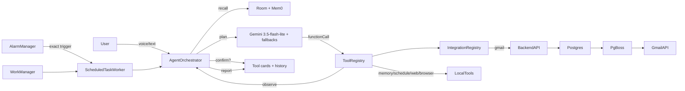

# JARVIS AI — Personal AI Agent (Aurviz SDE Assignment)

Native Android (Kotlin) personal AI agent + Node.js backend. Voice/text → Gemini reasoning
→ function tools → real actions (Gmail, controlled browser, cron routines, memory),
with explicit confirmation before anything sensitive.

- Repository: `https://github.com/Kaushalendra-Marcus/jarvis-ai`
- Package: `ai.jarvis.app` · minSdk 26 · targetSdk 34
- Backend (live): `https://jarvis-backend-71nz.onrender.com`
- AI tools used in development: ChatGPT, Claude/Codex-style assistants, Cursor — directed,
  reviewed, and validated by the developer (see §9).

## 1. Setup and execution

### Android app
1. Install Android Studio (or command-line tools) with JDK 17 and Android SDK 34.
2. `cp local.properties.example local.properties` and set `sdk.dir` (and optionally
   `gemini.api.key` — no key ships in the APK; a key typed in Settings → AI model works too).
3. Build: `./gradlew :app:assembleDebug`
   APK: `app/build/outputs/apk/debug/app-debug.apk` (~19 MB, committed build also in repo).
4. Install: `adb install -r app/build/outputs/apk/debug/app-debug.apk`
5. Tests: `./gradlew :app:testDebugUnitTest` — **112 tests, 0 failures** (20 suites).

### Backend
1. `cd backend && cp .env.example .env` and fill `DATABASE_URL`, `SESSION_SECRET`,
   `TOKEN_ENCRYPTION_KEY_B64`, `GOOGLE_CLIENT_ID/SECRET`, redirect URIs (all names in
   `.env.example`; never commit `.env`).
2. `docker compose up -d postgres && npx prisma migrate deploy` (production boots also
   self-apply the user-accounts DDL idempotently — no prisma CLI needed on the host).
3. `npm test` — **22 tests, 0 failures** (6 suites). Run: `npm run dev` (`ROLE=all`).

### First run (phone)
1. Onboarding → pick **My Gmail** or **Demo mailbox** (offline sample inbox, nothing real sent).
2. Settings → Account: create an account or log in (email + password, scrypt-hashed server-side).
3. Settings → Mailbox → **Sign in with Google**, approve all scope checkboxes → "Connected as …".
   Note: Google's OAuth app runs in Testing mode — accounts must be added under
   Audience → Test users; Gmail API must be enabled in the Cloud project.

## 2. Architecture

- `UI` (Compose only): Agent/Home orb, Chat (+ history drawer), Memory, Routines,
  Links, Mailbox, Browser, Settings (X-style: search + sub-screens). Details: `docs/jarvis/ARCHITECTURE_JARVIS.md`.
- `Reasoning`: `AgentOrchestrator` — bounded ReAct loop (8 interactive / 6 background steps):
  understand intent → retrieve memory context → plan (Gemini function-calling) →
  permission check (`isSensitive`/`requiresForeground`) → execute → observe →
  continue/recover → report. Live `ToolAction` states (`RUNNING → SUCCESS / FAILED / AWAITING_CONFIRMATION`).
- `Memory`: `SemanticMemoryStore` → `RoomSemanticMemoryStore` (offline-first Room) +
  `Mem0SemanticMemoryStore` (semantic cloud recall) → `Hybrid`. Teach/edit/delete in Memory tab.
- `Integrations`: `IntegrationRegistry` seam — Gmail (verified OAuth), Calendar (beta),
  Notion (validated token), custom MCP/OpenAPI (fail-closed UNVERIFIED placeholders).
- `Tools`: `AgentTool` + `ToolRegistry` — gmail search/read/draft/send, memory, scheduler,
  web, 10 browser tools, Notion. Sensitive tools are two-phase (`execute` prepares,
  `executeConfirmed` acts) and the LLM can never bypass the UI gate.
- `Scheduling`: `CronSchedule` (cron + "every morning at 8" NL) → one-time WorkManager
  chains + **exact `AlarmManager` triggers** (reboot-safe) with a run-token gate so the
  two triggers never double-execute. Backend `pg-boss` durable queue for email delivery.
- `Execution`: `ScheduledTaskWorker` (foreground-gated, retry/backoff policy) + email worker
  (`$transaction` claim, idempotent `Message-ID`, retry only on 429).

## 3. Voice-to-action pipeline
Mic → SpeechRecognizer → `AgentViewModel.sendPrompt` → orchestrator → Gemini →
function calls → tools → `functionResponse` → summary → TTS (spoken replies toggle,
en-IN/hi-IN). Microphone permission is requested once; spoken replies are opt-in.

## 4. Security, permissions, failure handling
- No API keys or OAuth tokens in git (`.env`, `local.properties` ignored; only `.example` files
  tracked). No bundled Gemini key (`hasBuiltInGeminiKey=false`).
- Android secrets in Keystore-backed `EncryptedSharedPreferences`; Google refresh tokens
  AES-256-GCM encrypted server-side; device sessions stored as SHA-256 hashes, single-use
  OAuth codes, `no-store` token responses, strict Zod schemas, HTTPS-only remotes.
- Sensitive actions (send email, browser click/type) pause for explicit approval showing the
  full content; the model is told cancelled actions must not be retried.
- Idempotency keys end-to-end (header → `scheduledEmail` unique key → stable Gmail
  `Message-ID`); retries only on 429/network with exponential backoff.
- Every layer maps errors to actionable text (session-expired → reconnect, scope/admin
  denials distinguished, offline → retryable). See `docs/jarvis/ARCHITECTURE_JARVIS.md`.

## 5. Performance (measured 25 Nov 2026)
- Android: **112 tests, 0 failures**; compile `BUILD SUCCESSFUL`.
- Backend: **22 tests, 0 failures** (`npm test`, ~2s).
- On-device telemetry (`RoomPerformanceRecorder`, Settings → Performance): `AGENT_TURN`,
  `LLM_CALL`, `MEMORY_RETRIEVAL`, `SCHEDULED_RUN` medians/p95 from real use.
- Optimizations: exact alarms beat Doze drift; Room-first memory keeps the hot path offline;
  `insertAndTrim` bounds history at 500 rows; pg-boss `batchSize:1 + singletonKey` for safe
  delivery. Details: `docs/jarvis/PERFORMANCE_JARVIS.md`.

## 6. Completed features
Voice + text agent, multi-provider LLMs, persistent + semantic memory, Gmail connect/search/
read/draft/send with approval, controlled browser (10 tools), cron + exact-alarm routines,
multi-step ReAct tasks, app accounts (signup/login/logout/sign-out-everywhere), Links catalog
(Gmail live, Notion validated, Calendar beta, custom MCP/OpenAPI placeholders), demo mailbox,
12-hour clock, X-style settings with search, notifications with sound/vibration toggles,
chat history drawer, dark/light themes.

## 7. Incomplete / known limits
- Google Calendar: `UNVERIFIED` placeholder — needs the Calendar OAuth scope.
- Custom MCP/OpenAPI: registered but fail-closed until schema validation lands.
- Google OAuth runs in **Testing mode** (100 test users) — production rollout needs Google's
  restricted-scope verification (incl. paid security assessment); out of scope for this build.
- School/work Workspace accounts whose admin blocks Gmail API cannot connect — the app
  detects this (`GMAIL_BLOCKED`) and directs to a personal account.
- `local.properties.example` contains a Mem0 key **prefix** from development — rotate the
  Mem0 key before sharing further.

## 8. Key challenges and solutions
1. **Doze vs on-time routines** → exact `AlarmManager` triggers + WorkManager fallback with a
   run-token single-execution gate (tested: `TaskRunGateTest`).
2. **OAuth on a free-tier backend** → server-side code exchange, opaque device sessions,
   encrypted refresh vault; deep-link callback `jarvis://oauth/callback`.
3. **Demo vs real confusion** → explicit `demo:true` flags, labeled demo strings, default
   lane is the user's own Gmail; tests cover both paths separately.
4. **Stale-connection UI** (Links tab disagreeing with Settings) → single source of truth
   (`BackendAuthManager.connectionState`) injected into the Links screen.
5. **Gmail 403 diagnosis** → server logs status+reason; client distinguishes missing scopes
   (reconnect with all boxes) from admin blocks (use personal account).

## 9. AI development tools
Built with ChatGPT, Claude-family assistants, and Cursor-style completion for scaffolding,
boilerplate, and test-drafting. Every AI contribution was directed by the developer, compiled,
executed against the 134-test suite, verified on-device over adb (screenshots, logcat), and
fixed by hand where it was wrong (OAuth client mismatch, stale-APK confusion, scope bugs).
Understanding and validation — not code volume — is the developer's contribution.
