<p align="center">
  
</p>

<h1 align="center">JARVIS AI</h1>

<p align="center">
  A personal AI agent for Android that talks, remembers, and gets things done.
  <br />
  Built with Kotlin, Jetpack Compose, Gemini, Node.js, and Postgres.
</p>

<p align="center">
  
  
  
  
</p>

<p align="center">
  <a href="https://youtu.be/iOAzHv7mw-E?si=BJlg9v9odykRwTRP"></a>
  &nbsp;
  <a href="https://drive.google.com/file/d/11331xOW9vMB5u6v04-E94jG57-t3mvN0/view?usp=sharing"></a>
</p>

> This repo is my submission for the Aurviz SDE hiring assignment: a personal AI agent
> Android app. Everything below is written from the actual code in this repo, and every
> number in it was measured today.

## What it does

You talk or type. Jarvis figures out what you mean, makes a plan, uses tools to do it,
and shows you each step as it happens. It remembers your preferences across restarts,
connects your real Gmail, browses the web in a controlled in app browser, and runs
routines on a schedule, even when the app is closed.

- Voice and text commands with spoken replies
- Real Gmail: search, read, draft, and send (sending always asks first)
- Memory that sticks: preferences, facts, and past chats, with semantic recall
- Routines like "every morning at 8, brief me", with an alarm that actually rings
- Controlled web browser the agent can open, scroll, read, and click through
- App accounts: signup, login, logout, and sign out everywhere
- Demo mailbox so reviewers can try everything without connecting anything

## How it works


A bounded ReAct loop runs every turn: understand what you said, pull in relevant memories,
plan with Gemini function calling, check permissions, run tools, read the results, and report
back. Sensitive actions never run silently. They pause, show you the full content, and wait
for your tap.

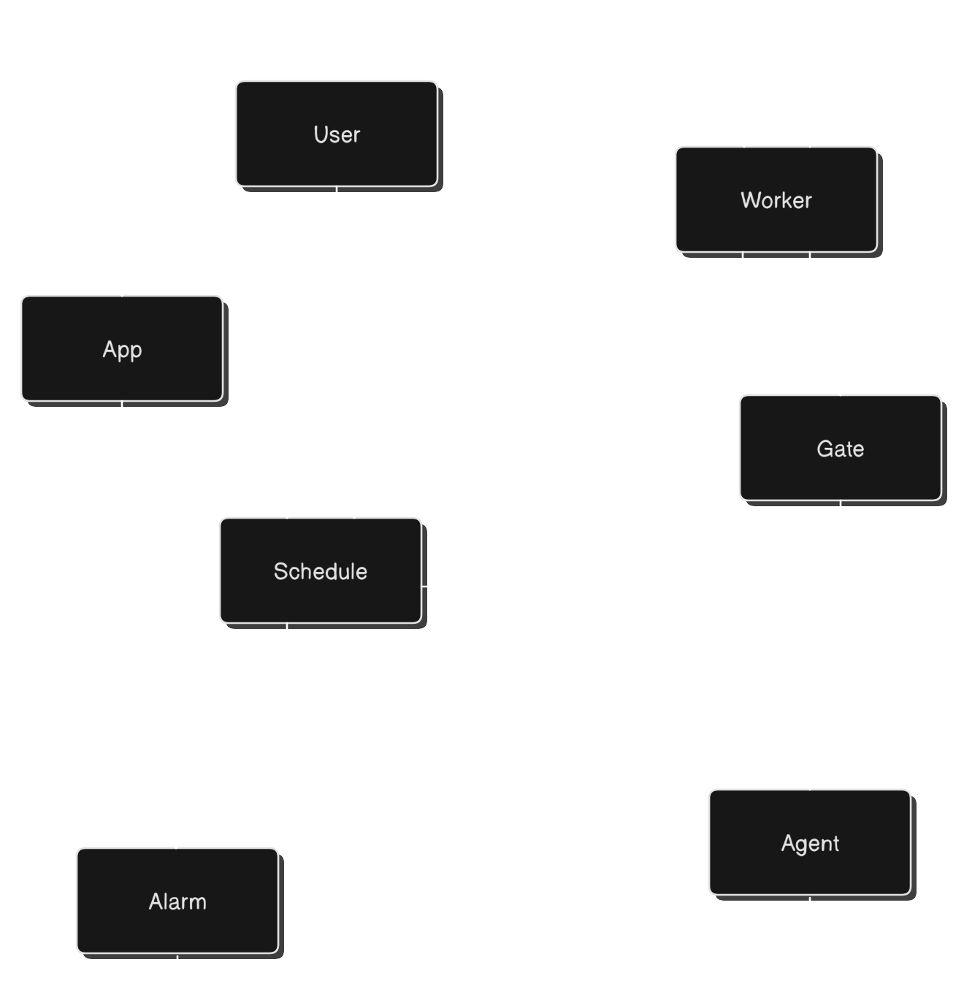

Routines get two triggers for reliability: an exact system alarm for on time delivery plus a
WorkManager chain as backup. A run token gate means only one of them ever executes.

Deeper docs live in [`docs/jarvis/`](docs/jarvis/): [architecture](docs/jarvis/ARCHITECTURE_JARVIS.md),
[performance](docs/jarvis/PERFORMANCE_JARVIS.md), [flow diagrams](docs/jarvis/FLOW_DIAGRAM.md).

## Get it running

### Android app

You need JDK 17 and Android SDK 34.

```bash
cp local.properties.example local.properties   # set sdk.dir inside
./gradlew :app:assembleDebug
```

The APK lands at `app/build/outputs/apk/debug/app-debug.apk` (~19 MB). Install it with:

```bash
adb install -r app/build/outputs/apk/debug/app-debug.apk
```

No build tools handy? Grab the ready APK straight from Drive:
`https://drive.google.com/file/d/11331xOW9vMB5u6v04-E94jG57-t3mvN0/view?usp=sharing`

No API key ships in the APK. Paste your Gemini key in Settings, AI model (or set
`gemini.api.key` before building). Tests:

```bash
./gradlew :app:cleanTestDebugUnitTest :app:testDebugUnitTest   # 112 tests, 0 failures
```

### Backend

```bash
cd backend
cp .env.example .env        # fill DATABASE_URL, SESSION_SECRET,
                            # TOKEN_ENCRYPTION_KEY_B64, GOOGLE_CLIENT_ID/SECRET
docker compose up -d postgres
npx prisma migrate deploy
npm test                    # 22 tests, 0 failures
npm run dev                 # ROLE=all on :3000
```

The production deploy on Render self applies the accounts migration on boot, so no
prisma CLI is needed on the host. Live at `https://jarvis-backend-71nz.onrender.com`.

### First run on the phone

1. Pick **My Gmail** or **Demo mailbox** (offline samples, nothing real is ever sent).
2. Settings, Account: create an account or log in.
3. Settings, Mailbox, **Sign in with Google**, and approve all the scope checkboxes.
   Two heads up from real testing: the Google OAuth app runs in Testing mode, so each
   account has to be added under Audience, Test users first. And the Gmail API has to be
   enabled in the Cloud project, or every Gmail call fails. School or work accounts whose
   admin blocks Gmail API access will not connect. A personal Gmail just works.

## Project map

```text
app/src/main/java/ai/jarvis/app/
├── presentation/      Compose screens only, no logic
│   ├── agent/         Home orb, Chat (+ history drawer, approval sheet)
│   ├── memory/        Memories, editor sheet
│   ├── tasks/         Routines, history, edit dialog
│   ├── integrations/  Links catalog, custom MCP/OpenAPI
│   ├── mailbox/       Inbox, Sent, Drafts
│   ├── browser/       Controlled in app browser
│   └── settings/      X style settings with search + sub screens
├── domain/
│   ├── orchestrator/  AgentOrchestrator (the ReAct loop)
│   ├── tool/          AgentTool contract + ToolRegistry
│   ├── integrations/  Integration seam + statuses
│   ├── schedule/      CronSchedule (cron + plain English)
│   └── model/         Messages, tasks, sensitive actions
├── data/
│   ├── remote/        Gemini + provider clients, backend API, auth managers
│   ├── mail/          Real backend mail vs demo mail gateway
│   ├── tools/         Gmail, memory, scheduler, web, browser, Notion tools
│   ├── integrations/  Registry impl, custom store, remote placeholders
│   ├── local/         Room database, DAOs, conversation files
│   └── repository/    Memory + scheduler repositories
├── service/
│   ├── background/    Task worker, exact alarms, boot receiver, run gate
│   ├── voice/         Speech recognition + TTS
│   └── web/           Scraper, browser controller + store
└── core/
    ├── security/      Keystore encrypted prefs
    └── util/          Time (12 hour clock), network monitor

backend/src/
├── routes/          auth (Google OAuth), users (accounts), emails, gmail
├── services/        google, gmail-inbox, email-service, token-vault, password
├── middleware/      device-auth (session + Google-account guards)
├── scheduler/       pg-boss email worker
└── utils/           zod validation
```

## Security choices

Nothing secret lives in git. `.env` and `local.properties` are ignored. Only `.example`
files are tracked. On the phone, keys and tokens sit in Keystore backed encrypted storage.
On the server, Gmail refresh tokens are AES-256-GCM encrypted and device sessions are
stored as SHA-256 hashes. OAuth codes are single use. Email sends carry idempotency keys
end to end, and retries only happen on rate limits or network drops. The model can never
skip the approval screen. Sending, browser clicks, and typing all wait for your tap.

## Performance (measured 25 Nov 2026)

- Android suite: **112 tests, 0 failures** across 20 files.
- Backend suite: **22 tests, 0 failures** in about 2 seconds.
- The app records its own timings on device (Settings, Performance): agent turns, LLM
  calls, memory lookups, and scheduled runs, with median and p95.
- Routines fire on time through Doze using exact alarms, proven by 6 single execution
  gate tests. Room first memory keeps the hot path offline. History tables stay bounded
  at 500 rows. Email delivery is transactional with one worker at a time.

One honest improvement left on the table: agent turns are sequential LLM round trips
(up to 8 steps). Streaming the first tokens while tools resolve would cut how long
replies feel, without changing what runs.

## What is done and what is not

Done: voice and text agent, multi provider LLMs, persistent plus semantic memory,
Gmail connect/search/read/draft/send with approval, controlled browser, cron plus exact
alarm routines, multi step tasks, app accounts, Links catalog (Gmail live, Notion
validated), demo mailbox, 12 hour clock, X style settings, routine alarms with sound,
chat history drawer.

Not done: Google Calendar (placeholder, needs the Calendar scope), custom MCP/OpenAPI
schema validation (registered but fail closed), production Google verification (Testing
mode with 100 test users is enough for review), and school/work accounts with an admin
blocked Gmail API cannot connect by design (the app says so plainly).

## Hard parts and how they got solved

1. Doze kept shifting morning routines. Fixed with exact AlarmManager triggers plus the
   WorkManager chain as backup, and a run token gate so the two can never double run.
2. OAuth on a free host. The whole exchange happens server side, the app only ever holds
   an opaque device token, and Gmail links into the same session when you are logged in.
3. Personal memory for the specific user. Memories must belong to the signed in user
   only and never leak across accounts. Room rows are per install, Mem0 calls carry a
   per user id, and encrypted prefs are keyed per user, so one person's facts can never
   surface in another person's chat.
4. MCP addition tokens authorisation. Custom MCP and OpenAPI integrations bring their
   own user tokens, so the registry reads each token live from its connected catalog
   entry instead of caching it. Revoking on the provider side cuts access immediately,
   and unregistered tools stay fail closed.
5. A Links screen that disagreed with Settings. One source of truth now: the backend
   connection state flows into both.
6. Gmail 403s that all looked alike. The server now tells missing scopes apart from
   admin blocks, and each message says what to actually do.

## Built with AI, checked by a human

Built with **OpenCode** powered by **Muse Spark 1.3 (contributor)**. It drafted
scaffolding and tests. I directed the design, ran all 134 tests, verified everything
on a real phone, and fixed each failure by hand.

## Walkthrough

Home orb with voice, then chat. Ask anything or pick a suggestion.

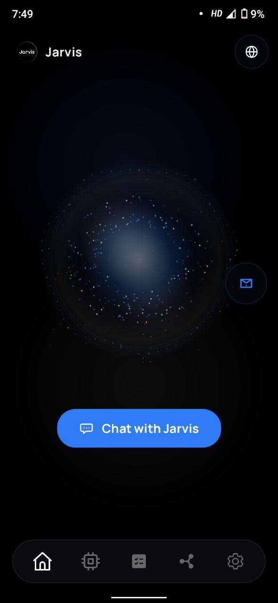
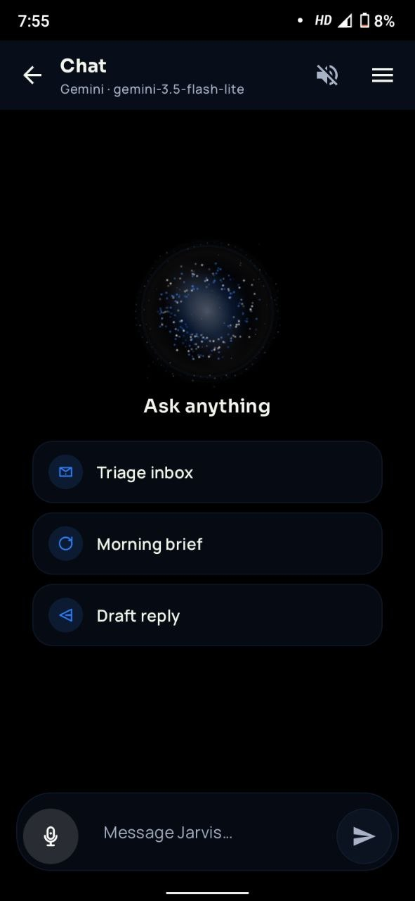

Multi step work: the agent opens the web, reads it, recalls the preferred email from
memory, and saves a real Gmail draft. A live search returning real inbox results:

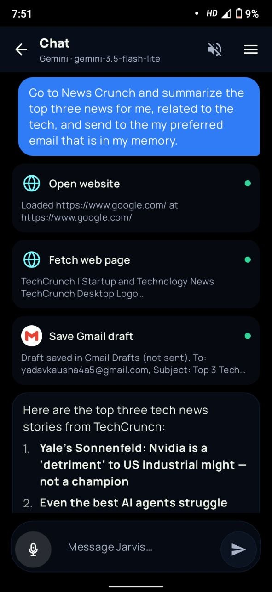
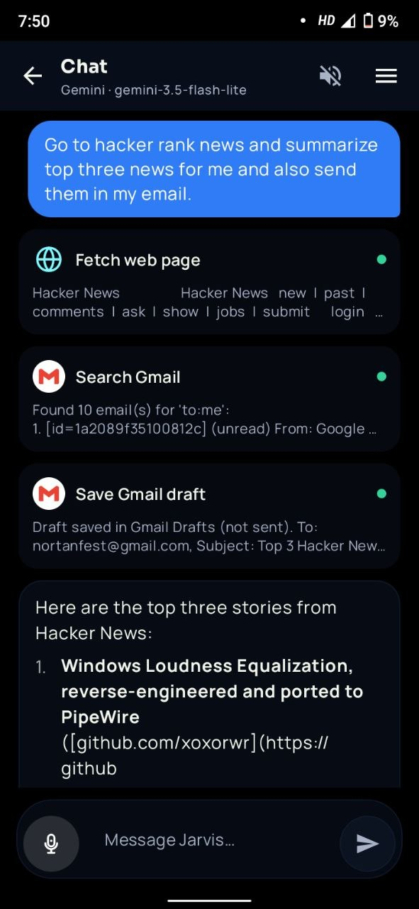

A real run: asked to draft an email, the agent searches Gmail, checks memory, asks for
the missing address, then saves the draft without sending:

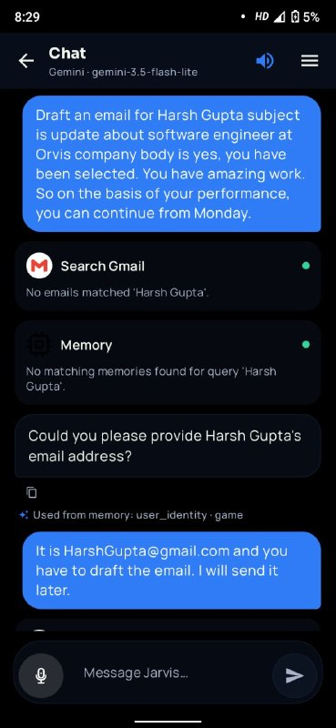
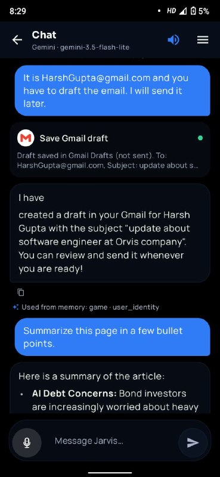

Memory keeps everything with 12 hour timestamps. Routines run on their own schedule:

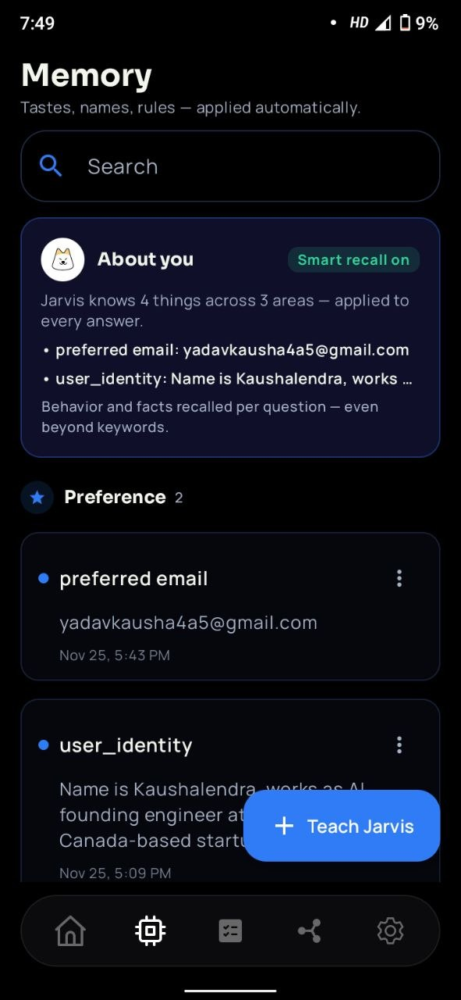
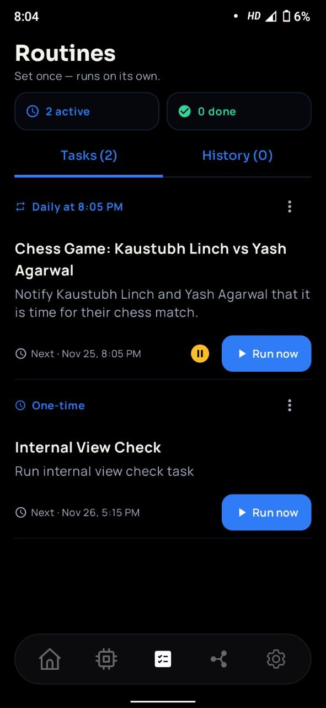

Links shows Gmail live. Mailbox connects the real inbox:

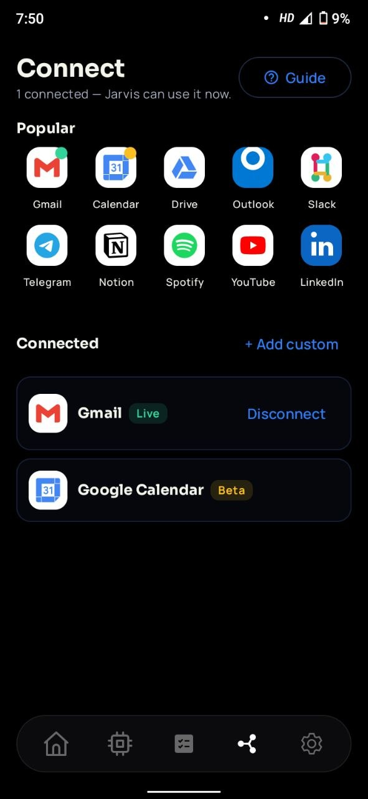
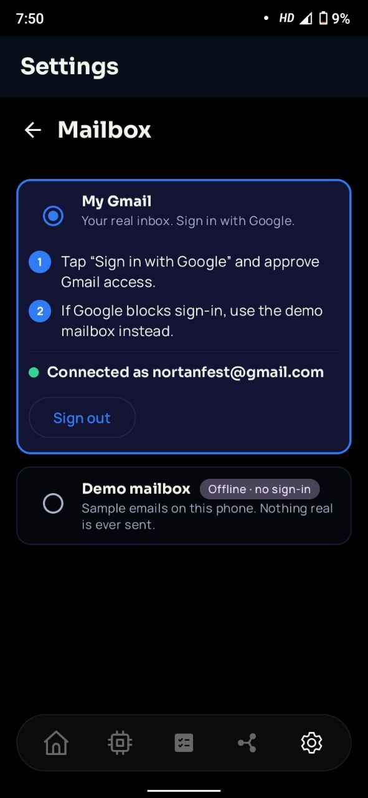

Four AI providers with encrypted keys, and X style settings with search:

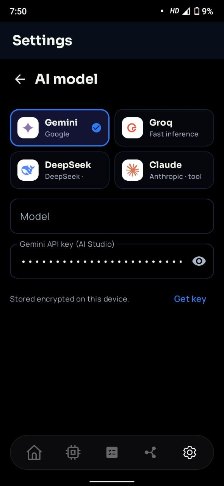
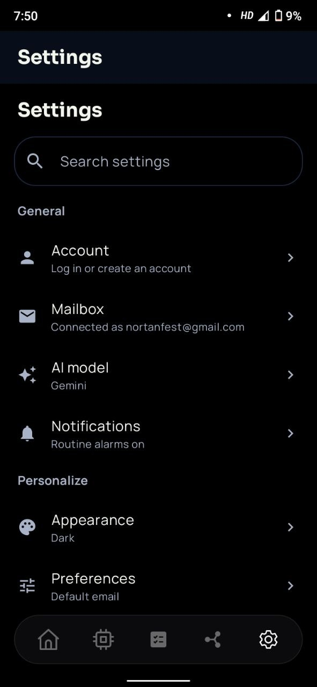

## License

MIT. See [LICENSE](LICENSE).
