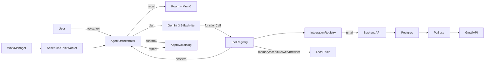

# JARVIS AI — Architecture

## Modules (deep, testable seams)
- `UI`: Agent/Memory/Tasks/Integrations/Browser/Settings — Compose only, no logic
- `Reasoning`: `AgentOrchestrator` (ReAct 8/6 steps) + `GeminiAgentClient` (REST + fallback models)
- `Memory`: `SemanticMemoryStore` → `RoomSemanticMemoryStore` (offline) + `Mem0SemanticMemoryStore` (semantic) → `Hybrid`
- `Integrations`: `IntegrationRegistry` → `IntegrationRegistryImpl` (gmail verified, calendar UNVERIFIED, mcp:/openapi: dynamic)
- `Tools`: `AgentTool` + `ToolRegistry` (gmail/search/read/draft/send, memory, scheduler, web, browser×10)
- `Scheduling`: `CronSchedule` + `TaskSchedulerRepositoryImpl` (WorkManager) + backend `pg-boss` durable queue
- `Execution`: `ScheduledTaskWorker` (foreground-gated) + `email-service.js` ($transaction claim)

## Agent loop (Req.4)
`understand intent → retrieve context (Room+Mem0) → plan (Gemini) → validate permissions (isSensitive/requiresForeground) → execute tools → observe results → continue/recover (nudge/rate-limit fallback) → report completion` with live `ToolAction` status.

## Security (Req.9)
No APK keys (`SecurePreferences` user-only), AES-256-GCM refresh tokens, sha256 opaque tokens, Zod strict schemas, `Idempotency-Key` + `singletonKey`, confirmation gate, HTTPS-only MCP/OpenAPI.
