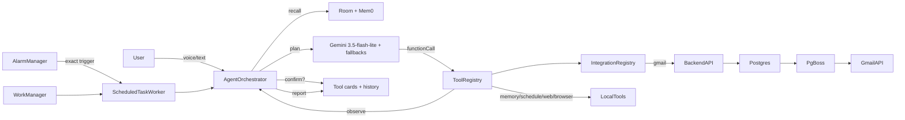

# JARVIS AI — Architecture (25 Nov 2026)

Entry point: [`README.md`](../../README.md). Numbers below are certified today:
Android **112 tests / 0 failures** (20 suites), backend **22 / 0** (6 suites).

## Modules (deep, testable seams)
- `UI`: Agent/Home orb, Chat (+ history drawer), Memory, Routines, Links, Mailbox,
  Controlled browser, Settings (X-style: search + sub-screens) — Compose only, no logic.
- `Reasoning`: `AgentOrchestrator` (bounded ReAct: 8 interactive / 6 background steps) +
  `ProviderAgentClient` → `GeminiAgentClient` (REST, model fallback chain) for Gemini, Groq,
  DeepSeek, Claude dialects normalized to one response shape.
- `Memory`: `SemanticMemoryStore` → `RoomSemanticMemoryStore` (offline Room, source of truth)
  + `Mem0SemanticMemoryStore` (cloud semantic recall) → `HybridSemanticMemoryStore`.
- `Integrations`: `IntegrationRegistry` → `IntegrationRegistryImpl` — Gmail verified,
  Notion token-validated, Calendar `UNVERIFIED`, custom MCP/OpenAPI fail-closed.
- `Tools`: `AgentTool` (`isSensitive`, two-phase `execute`/`executeConfirmed`) + `ToolRegistry`
  (gmail search/read/draft/send, memory, scheduler, web, 10 browser tools, Notion).
- `Scheduling`: `CronSchedule` (cron + NL "every morning at 8") + `TaskSchedulerRepositoryImpl`
  (one-time WorkManager chains) + `TaskAlarmScheduler` (exact alarms, reboot-safe) +
  `TaskRunGate` (single-execution across both triggers) + backend `pg-boss` email queue.
- `Execution`: `ScheduledTaskWorker` (foreground-gated, `TaskExecutionPolicy` retry/backoff,
  audible alarm notification) + `email-service.js` (`$transaction` claim, idempotent send).
- `Identity`: `UserAccountManager` + `/api/v1/users` (scrypt accounts, sessions unify
  user + Google; link-on-OAuth, logout, sign-out-everywhere).

## Agent loop (Req.4)
`understand intent → retrieve context (Room+Mem0) → plan (Gemini) → validate permissions
(isSensitive/requiresForeground) → execute tools → observe results → continue/recover
(nudge/rate-limit fallback) → report completion` with live `ToolAction` status
(`RUNNING → SUCCESS / FAILED / AWAITING_CONFIRMATION`).

## Voice-to-action pipeline
Mic (`RECORD_AUDIO`, one-time prompt) → SpeechRecognizer → `AgentViewModel.sendPrompt` →
orchestrator → Gemini → function calls → tools → `functionResponse` → summary bubble →
TTS spoken reply (opt-in switch, en-IN/hi-IN). Voice errors clear after ~2.6s, never stick.

## Memory storage and retrieval
Writes: agent `MemoryTool` / "Teach Jarvis" FAB / editor sheet → Room (`MemoryDao`).
Reads: keyword + semantic recall merged per turn (`HybridSemanticMemoryStore`), quoted back
in answers ("Used from memory: …"). Deletes/edits propagate immediately; overflow (•••)
menus keep rows clean. Mem0 key optional — blank means Room-only offline mode.

## Scheduling and background execution
`SchedulerTool` parses NL/cron → `scheduleTask` computes `nextRunEpoch`, enqueues a
one-time worker AND sets an exact alarm with the same run token. First claimant in
`TaskRunGate` runs; the loser exits. Retries release the token first. `BOOT_COMPLETED`
re-registers alarms; `ensureScheduled()` repairs WorkManager chains on launch. Email
delivery itself is durable server-side (pg-boss, `singletonKey`, retry only on 429).

## Security (Req.9)
No APK keys (`SecurePreferences` user-only; `hasBuiltInGeminiKey=false`), Keystore-backed
encrypted prefs on device, AES-256-GCM refresh tokens + SHA-256 session hashes server-side,
single-use OAuth codes, `Cache-Control: no-store` token responses, strict Zod schemas,
`Idempotency-Key` + stable Gmail `Message-ID`, confirmation gate the LLM cannot bypass,
HTTPS-only remotes, rate-limited auth endpoints, no token/email logging.

## Decisions and trade-offs
1. One-time WorkManager chains (not periodic jobs) so weekday/cron rules are expressible;
   exact alarms cover Doze drift; token gate prevents double runs.
2. Server-side Gmail (not on-device OAuth): secrets never ship, one redirect URI to verify,
   durable queued sending. Cost: needs the Render host awake (warm-up call + long timeouts).
3. Demo mailbox alongside real Gmail: reviewers evaluate without credentials; explicit
   `demo:true` flags and labels prevent either path masquerading as the other.
4. Google OAuth stays in Testing mode (100 test users): production rollout needs Google's
   restricted-scope verification (paid assessment) — out of scope; documented in README.
5. Deployed backend self-applies the accounts DDL idempotently — no prisma CLI on the host.
