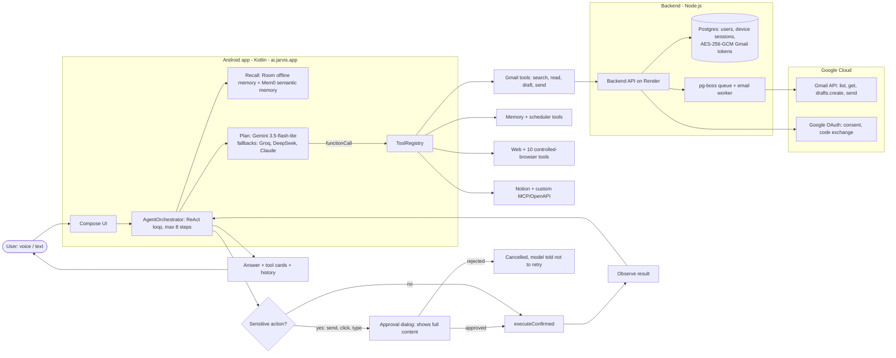
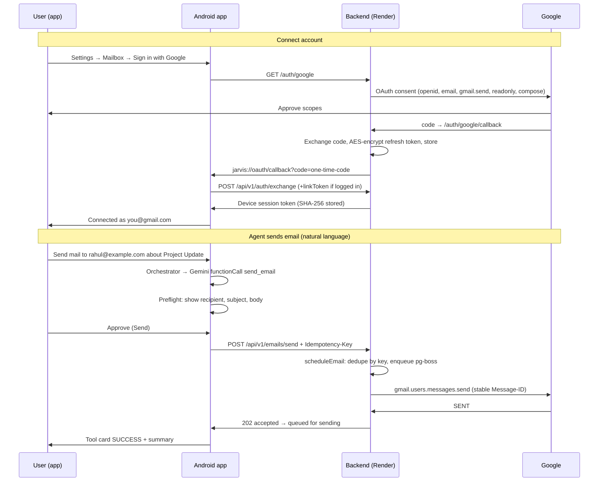
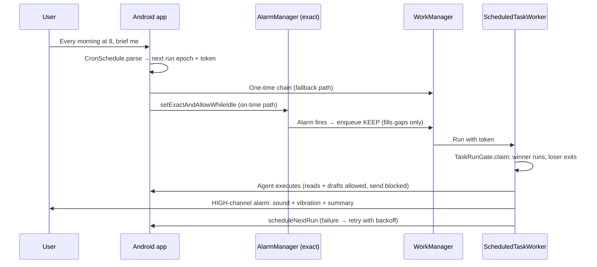

# JARVIS AI Flow diagrams (paste into Eraser)

How to use: copy ONE mermaid block below → open your Eraser workspace →
new diagram → paste the code into Eraser's AI chat (or https://www.eraser.io/ai/mermaid-diagram-editor)
→ Generate. Eraser redraws it as a native, editable diagram.

## 1. System architecture + agent loop (flowchart)

## 2. Gmail connect + send flow (sequence)

## 3. Routine scheduling + alarm flow (sequence)

